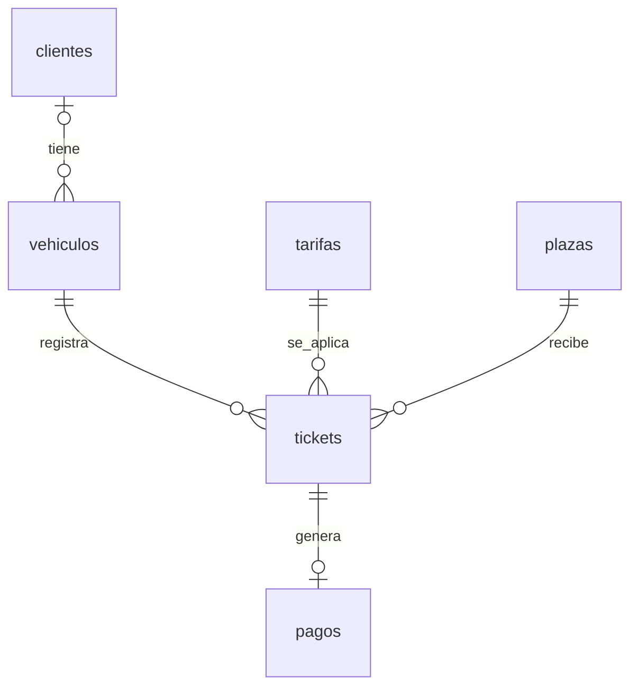

# Parking Control

Sistema sencillo para registrar ingresos, salidas y pagos de un estacionamiento.

## Cómo usarlo

1. Instalá Node.js 22 o superior y tené MySQL en ejecución.
2. Abrí [base_de_datos.sql](base_de_datos.sql) en MySQL Workbench y ejecutalo completo para crear la base y cargar los datos de prueba.
3. En PowerShell, configurá las variables de entorno de MySQL. Usá tu usuario y tu contraseña.

   ```powershell
   $env:DB_HOST = '127.0.0.1'
   $env:DB_USER = 'root'
   $env:DB_PASSWORD = 'tu_contraseña'
   $env:DB_NAME = 'parkingcontrol'
   ```

4. En la misma consola, desde la carpeta del proyecto, ejecutá `npm install` y luego `npm run dev`.
5. Abrí [http://127.0.0.1:3000](http://127.0.0.1:3000).

El sistema cobra una hora como mínimo. Cada fracción se redondea hacia arriba. Por ejemplo, un automóvil que estuvo 1 hora y 20 minutos paga $4.000. Se usa el precio guardado al ingresar. La pantalla de clientes mensuales permite registrar y consultar el nombre, el teléfono y el estado de la suscripción.

Ejecutá [consultas.sql](consultas.sql) en MySQL para ver la disponibilidad por sección, los vehículos activos, la recaudación por método y el tiempo promedio. Cambiá `@fecha` para consultar otro día.

## Diagrama entidad-relación



Cada ticket corresponde a un vehículo, una tarifa y una plaza. Los tickets abiertos quedan con `salida` vacía. Al cerrar un ticket se guarda un solo pago. La relación con clientes es opcional para los vehículos.

## Diccionario de datos

| Tabla | Campo | Tipo | Descripción y restricciones |
| --- | --- | --- | --- |
| clientes | id | INT | PK, autoincremental |
| clientes | nombre | VARCHAR(100) | Nombre completo, obligatorio |
| clientes | telefono | VARCHAR(25) | Teléfono, obligatorio |
| clientes | estado | ENUM | Activa o Inactiva, obligatorio |
| tarifas | id | INT | PK, autoincremental |
| tarifas | tipo | VARCHAR(30) | Tipo de vehículo, obligatorio y único |
| tarifas | precio_hora | DECIMAL(10, 2) | Importe por hora o fracción, obligatorio |
| plazas | id | INT | PK, autoincremental |
| plazas | codigo | VARCHAR(10) | Código de la plaza, obligatorio y único |
| plazas | seccion | VARCHAR(10) | Sección del estacionamiento, obligatoria |
| plazas | estado | ENUM | Disponible, Ocupada o Mantenimiento, obligatorio |
| vehiculos | id | INT | PK, autoincremental |
| vehiculos | patente | VARCHAR(15) | Patente, obligatoria y única |
| vehiculos | cliente_id | INT | FK a `clientes.id`, admite NULL |
| tickets | id | INT | PK, autoincremental |
| tickets | vehiculo_id | INT | FK a `vehiculos.id`, obligatoria |
| tickets | tarifa_id | INT | FK a `tarifas.id`, obligatoria |
| tickets | plaza_id | INT | FK a `plazas.id`, obligatoria |
| tickets | precio_hora | DECIMAL(10, 2) | Precio al momento del ingreso, obligatorio |
| tickets | entrada | DATETIME | Fecha y hora del ingreso, obligatoria |
| tickets | salida | DATETIME | Fecha y hora de la salida, admite NULL |
| pagos | id | INT | PK, autoincremental |
| pagos | ticket_id | INT | FK a `tickets.id`, obligatoria y única |
| pagos | monto | DECIMAL(12, 2) | Total cobrado, obligatorio |
| pagos | metodo | ENUM | Efectivo, Tarjeta o Transferencia, obligatorio |
